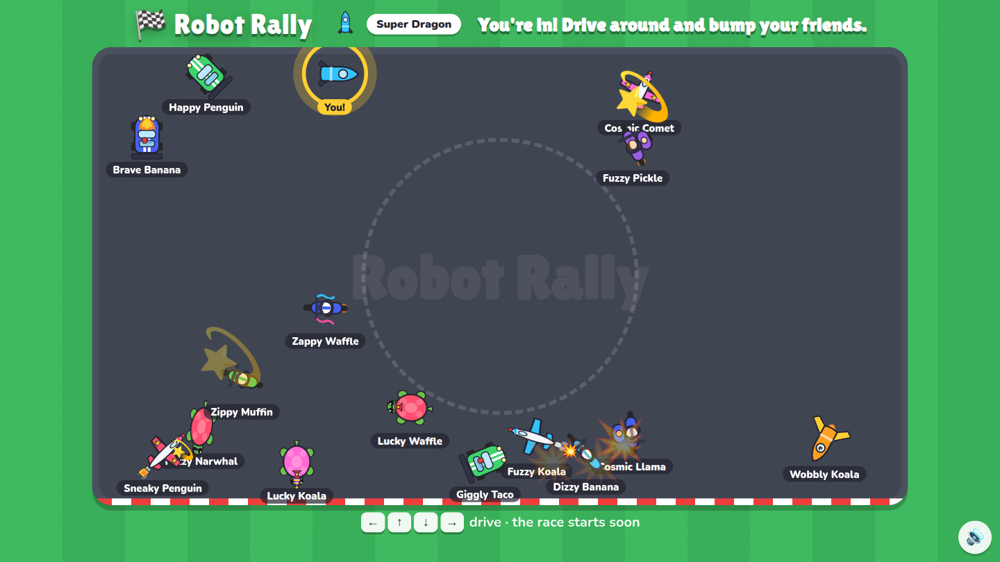
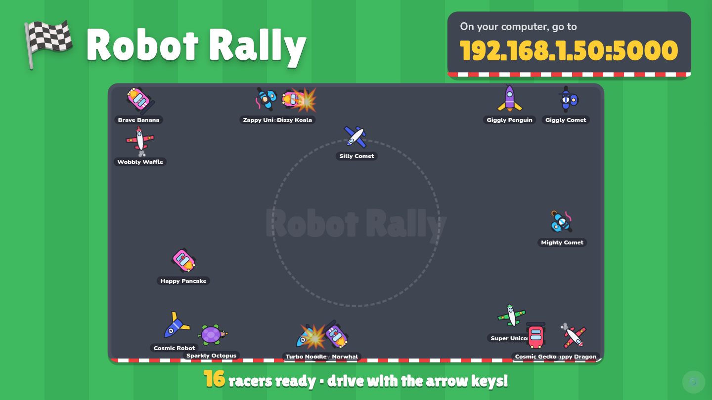
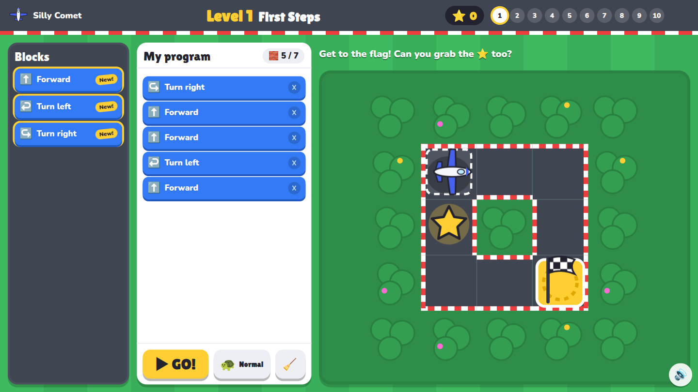
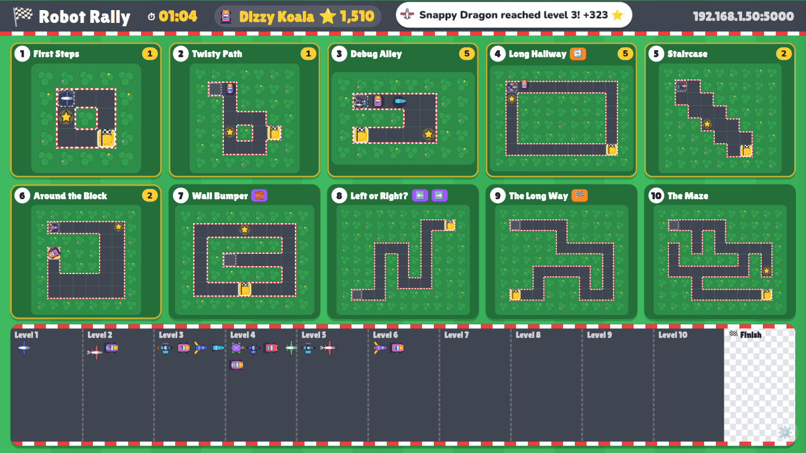
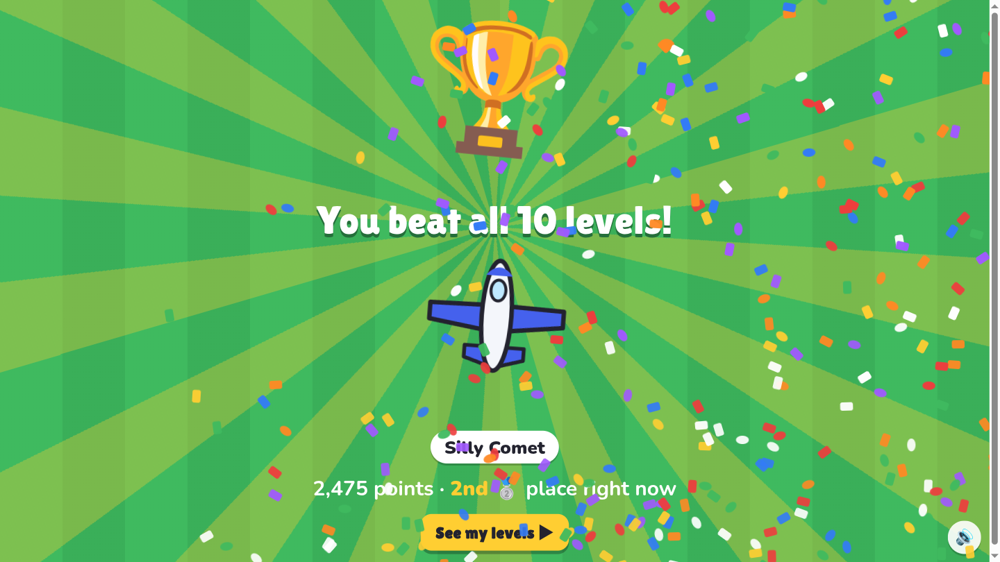
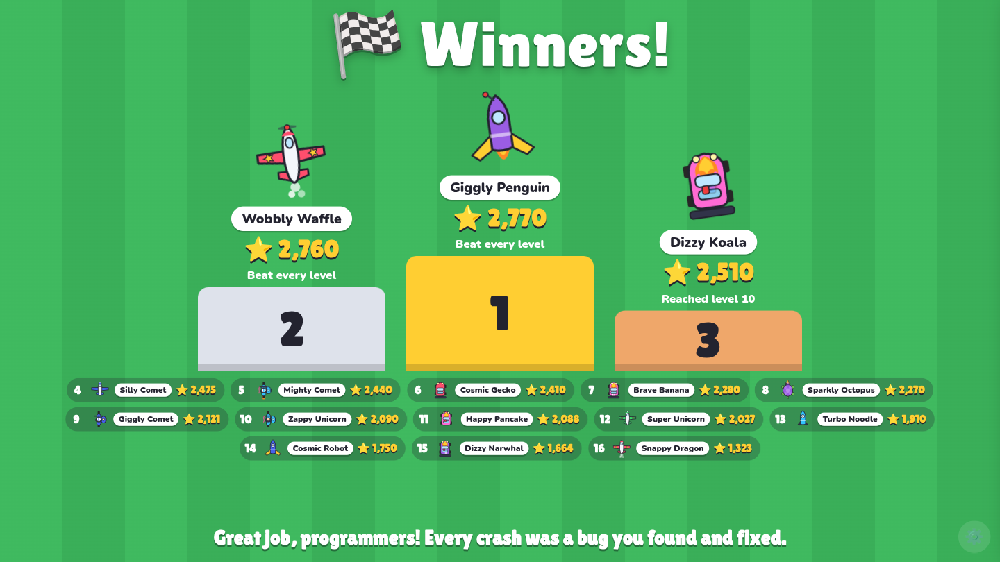
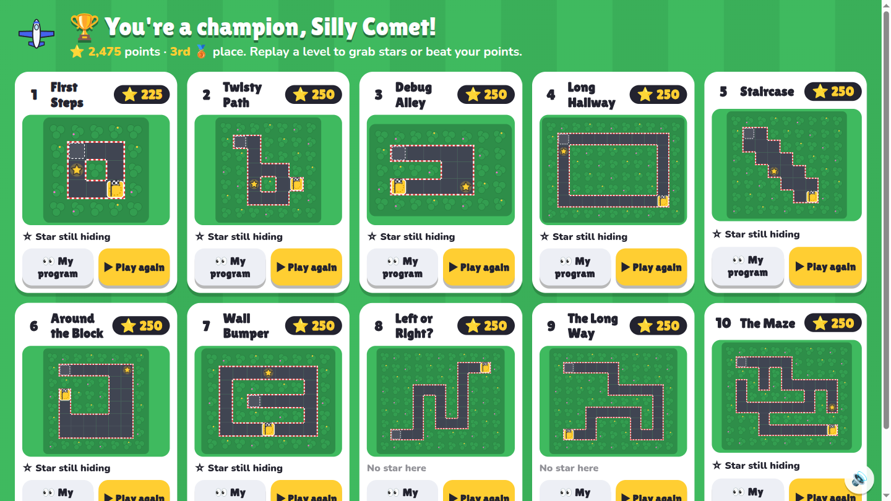

# Robot Rally

Kids program a racer through 10 grid mazes by dragging blocks (Forward, Turn, Repeat, If, Repeat until flag). Everyone races at the same time, and the projector shows a shared race course. Built for a ~30-minute science-night slot with up to 24 lab machines.

- Kids open `http://<laptop-ip>:5000`
- The projector opens `http://<laptop-ip>:5000/admin` (password below)

## Screenshots

| Kid's screen | Projector |
|---|---|
|  **Lobby:** drive around and bump your friends while everyone signs in. |  **Lobby:** the join address, with everyone driving around. |
|  **Race:** drag blocks into a program and press GO. The ⭐ is a bonus for taking the long way. |  **Race:** all 10 levels live, the points leader, and everyone's progress along the bottom. |
|  **Beat every level:** a big celebration first… |  **Winners:** the podium by points, and everyone else below it. |
|  **…then My levels:** see your winning programs and replay any level for more points. | |

## Desktop app

The easiest way to run a session: install Robot Rally for your computer from the [latest release](https://github.com/SnowSE/robotrally/releases/latest) (Windows, Mac, or Linux; no .NET install needed) and run it. It keeps itself up to date: new releases download in the background and the projector offers **Restart** (or the update installs when you close the app). The projector page opens in its own window, already logged in, and kids on other computers join at the address it shows. It uses port 5000, or the next free port if something else has it (the address on screen shows which). **🧒 Race on this computer too** (under the join address, and in the controls) opens a racer window on this computer. The release notes cover the first-run warnings (the app isn't code-signed). Closing the window ends the game.

Every push to `main` runs the tests and publishes a new release (`v1.0.<build number>`) through `.github/workflows/release.yml`, packaged with [Velopack](https://velopack.io), which also handles the updates (`DesktopUpdates.cs`). The desktop app (`src/RobotRally.Desktop`) is a thin shell: it runs the same server in-process (`RobotRallyServer.Create`) and shows `/admin` in a [Photino](https://www.tryphotino.io/) window, which uses the system's web view (WebView2, WKWebView, or WebKitGTK). To build one yourself: `dotnet publish src/RobotRally.Desktop -c Release -r linux-x64 -o out` (or `win-x64`, `osx-arm64`, `osx-x64`); a copy run that way doesn't update itself.

## Run it from source

For the event, run it in Production. This turns off the practice-bot endpoint and the detailed error pages:

```bash
cd src/RobotRally
ASPNETCORE_ENVIRONMENT=Production ROBOTRALLY_ADMIN_PASSWORD=pick-one dotnet run -c Release --no-launch-profile
```

When it starts, it prints the URLs for the kids. The laptop has more than one network address, so check which one the lab machines can reach. If the projector shows the wrong one, pin it:

```bash
JoinUrl=http://192.168.1.50:5000 ASPNETCORE_ENVIRONMENT=Production ROBOTRALLY_ADMIN_PASSWORD=pick-one dotnet run -c Release --no-launch-profile
```

If you don't set a password, it's `rally`.

### Open the firewall for the night (Fedora / firewalld)

If your firewall blocks 5000/tcp (zone `FedoraWorkstation` here; use yours), open it for this boot only. Nothing is saved, so it closes again on reboot or `firewall-cmd --reload`:

```bash
sudo firewall-cmd --zone=FedoraWorkstation --add-port=5000/tcp
# afterwards:
sudo firewall-cmd --zone=FedoraWorkstation --remove-port=5000/tcp
```


## Running the session

On the projector, **Esc** opens the controls. **F** toggles full screen.

1. **Lobby.** The projector shows the join URL. Kids build a racer (ride, add-ons, color, random silly name) and drop onto a bumper-car floor. They drive with the arrow keys (or WASD) and bounce off each other. Each kid's own machine plays a soft "boop" only for their own bumps; the projector stays quiet.
   - **👑 King of the Hill:** whoever drives into the glowing circle in the middle holds it, and a timer counts up. Other cars can drive in, but they have to bump the holder out to take over (the timer starts again). The holder gets a crown that grows at 10, 20 and 30 seconds. On a knockout the projector shows **DETHRONED!** and the crown hops to the new holder; the kid who stole it gets confetti. The projector footer keeps a Hall of Fame of the three longest reigns (each kid's best). The reign pauses during the demo and ends when the race starts. If it gets too wild, turn it off under **Lobby fun** in the controls (Esc).
2. **Demo.** Choose **▶ Play demo** for the narrated walkthrough. Press **Space** or **→** for each next step (a yellow "Space ▶" shows when it's ready) and **←** to start over. It covers dragging blocks, GO!, a crash with the 🐞 bug marker, fixing it, the block limit, Repeat, and If. **🎮 Live demo** gives you the real editor on any level (or the sandbox), with a **Show a solution** button.
3. **Start race.** There's a 3-2-1-GO countdown, then every kid's screen switches to Level 1. Kids who join late start at Level 1.
4. **Race.** The projector shows all 10 levels live, a race-track ribbon of everyone's progress, and the current points leader. A banner announces each level-up with the points earned.
   - **🐢 / 🐇** next to GO! makes a kid's racer drive 2.5× faster, even mid-run.
   - Kids in the back 30% of the pack (by level, then points) get a **💡 Hint** button with three hints for their level, gentlest first. The last one shows how the program could start. Nobody gets hints at the very start, while everyone is tied.
   - A kid who beats all 10 levels gets a big celebration, then a **My levels** screen: their winning program for every level, and **Play again** on any level to grab missed stars or beat their points (only their best score per level counts).
5. **Winners.** The race runs until you click **🏆 Finish race & show scores**. The podium ranks by points, then level reached, then who got there first. A winning run that's still celebrating when you click still counts.
6. **Next group:** **🔄 New group (reset)** removes everyone, and every kid's screen goes back to the character builder. **🔁 Same kids race again** keeps the racers and wipes their progress.

The player list in the controls panel can remove a stray tab (✖, then confirm).

### Levels

| # | Name | New block | Limit | Bonus ⭐ |
|---|---|---|---|---|
| 1 | First Steps | Forward, Turn left, Turn right | 7 | the other way round the hedge (+1 block) |
| 2 | Twisty Path | — | 14 | the lower loop (+2 blocks) |
| 3 | Debug Alley | — | 12 | the far side of the wide corner (+2 blocks) |
| 4 | Long Hallway | Repeat | 6 | go down first, then along (+1 block) |
| 5 | Staircase | — | 6 | the lower staircase (+1 block) |
| 6 | Around the Block | (a repeat inside a repeat) | 5 | the bigger square (same blocks, longer drive) |
| 7 | Wall Bumper | If wall ahead | 5 | turn left at walls instead of right (the long way) |
| 8 | Left or Right? | If path to the left / right | 6 | — |
| 9 | The Long Way | Repeat until flag | 6 | — |
| 10 | The Maze | (wall-follower algorithm) | 8 | a dead end only the left-hand wall follower visits |

Reference solutions are in `Levels.Solution(n)`, star routes in `Levels.StarSolution(n)`, and hints in `Levels.Hints(n)` (all in src/RobotRally.Game/Levels.cs). The live demo shows the reference solutions. Level 10's reference is the right-hand wall follower: `Repeat until flag { if path right → turn right; if wall ahead → turn left; if wall ahead → turn left; forward }`.

### Points

Each solved level is worth:

- **100** for making it
- up to **100** for speed: full points within the level's par time (20 s for level 1, then 10 s more per level), sliding to 0 four minutes after par. The clock runs from reaching the level to pressing GO!, so slow animations and long star routes don't cost speed points.
- up to **50** for few blocks: full points at the reference solution's block count, minus 10 per extra block
- **100** per bonus star, but only if that run reaches the flag

The rules are in `src/RobotRally.Game/Scoring.cs`.

## Rehearse

In Development (plain `dotnet run`, which uses the launch profile), `http://localhost:5000/dev/bots?n=14` adds practice racers. They wander the bumper-car lobby, crash a lot in the race, and sometimes solve their level (sometimes grabbing the star), so you can see a busy projector. They're removed by **New group**.

To see the finish screens without solving everything by hand, `http://localhost:5000/dev/solve?token=<token>` solves a racer's current level with the reference solution. Call it again after each win. The token is `rr-token` in the kid browser's localStorage.

## Pre-event checklist

- [ ] Open port 5000 (above) and confirm the kids' URL loads on one lab machine.
- [ ] On that lab machine, check that drag-and-drop works, that sound plays, that the arrow keys drive in the lobby, and that a refresh comes back as the same racer.
- [ ] Projector: log in, press F for full screen, and run the scripted demo once.
- [ ] Do a dry run with bots, then **New group**.

## Develop

```bash
dotnet test            # rules, levels (every level is checked solvable and loop-requiring), game service
```

- `src/RobotRally.Game` holds the pure rules: levels, interpreter, playback timing, and the in-memory `GameService`.
- `src/RobotRally` is the Blazor Server UI. All sounds are synthesized in `wwwroot/js/rally.js`, and all art is SVG in `Components/Shared/CharacterArt.razor`.
- Game state lives in memory, so restarting the server ends the session.

Design spec: `docs/superpowers/specs/2026-11-04-robot-rally-design.md`.
